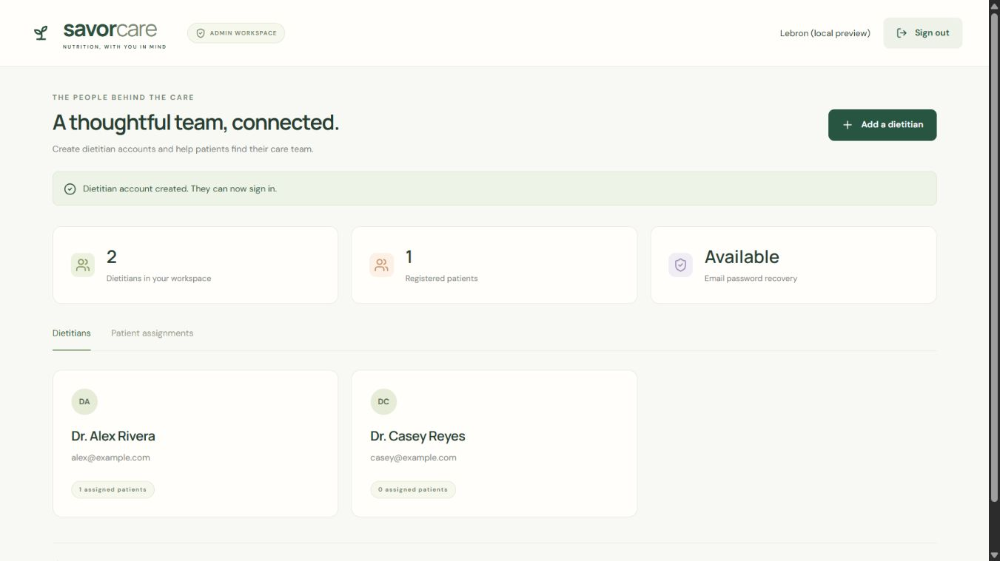
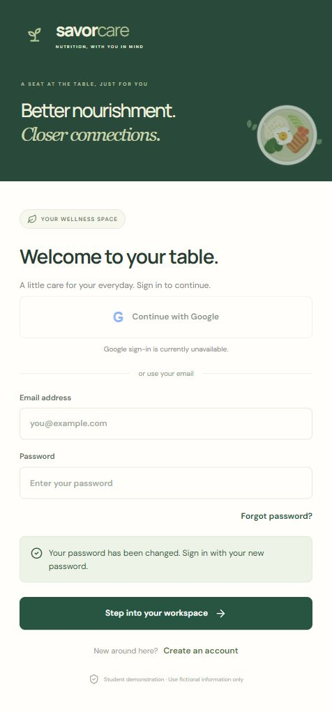

# Account management verification

Date: 31 October 2026

## Implemented

- An owner-provisioned administrator with no public admin registration.
- An admin workspace for creating dietitians and assigning patients.
- Administrator password confirmation before creating a dietitian.
- Existing patient/provider records retained without rebuilding the users table.
- Forgot-password and reset-password screens for all three roles.
- Thirty-minute, hashed, single-use recovery tokens with session revocation.
- Generic recovery responses and a persistent per-email cooldown.
- Gmail delivery over HTTPS using a send-only OAuth grant.
- Google sign-in with state, browser binding, PKCE, ID-token verification, and nonce checking.
- Google users receive patient access by default; privileged roles come from existing authorized accounts.

## Automated checks

The expanded suite contains 43 tests. It has passed with both built-in SQLite and asynchronous local libSQL. The production frontend build also passes.

New coverage includes admin authorization and reauthentication, duplicate accounts, patient assignment guards, recovery for all roles, token expiry/replay/concurrent use, unknown-address responses, unconfigured delivery, Gmail message encoding, Google state/PKCE/nonce checks, role retention, and existing-data preservation when bootstrapping an admin. Bootstrap credentials can be removed after initial setup without changing the saved admin account.

The preservation fixture adds a custom patient, assignment, saved Tinola entry, and session before applying the account update, then confirms those records remain.

## Browser checks

A temporary local server used only fictional accounts and an injected simulated mail sender:

1. Signed in as an administrator.
2. Created a dietitian and saw the new account in the admin list.
3. Opened patient assignments.
4. Verified no horizontal overflow at 390 × 844.
5. Requested recovery for the new dietitian.
6. Opened the simulated recovery link and set a new password.
7. Signed in with the new password and received the dietitian workspace.

The recovery token is removed from the address bar after the page reads it. A reset link also works when opened within an already-running app.

The “Available” email status in this local screenshot reflects the injected test sender. It does not show a live Gmail connection.

## Hosted verification still required

- Owner creates the first real admin through private Render environment values.
- Google client and Gmail sender are configured.
- Real Google consent, callback, and role behavior are tested with owner-controlled accounts.
- Recovery email inbox delivery is confirmed for patient, dietitian, and admin.

Google tests use a mock token verifier and Gmail delivery uses mocked HTTPS responses. No real Google tokens or recovery emails were used for the automated checks.

The earlier Turso persistence test was reported passed by the owner: the Tinola entry remained after a Render redeployment. That is separate from acceptance of these new account features.

See [setup instructions](ADMIN-GOOGLE-SETUP.md).
