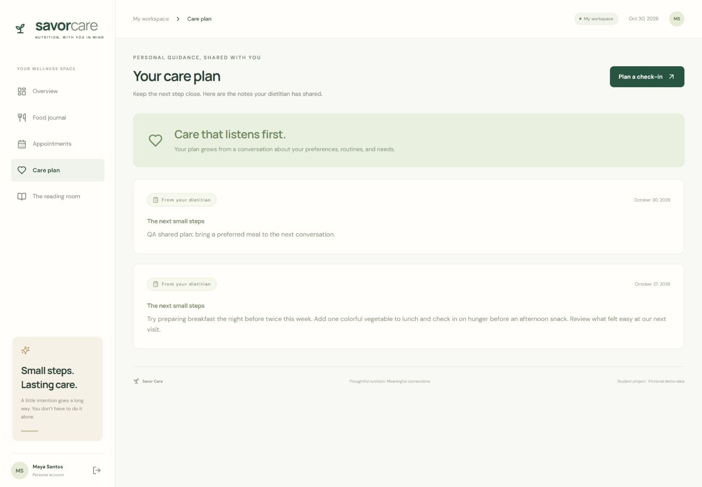
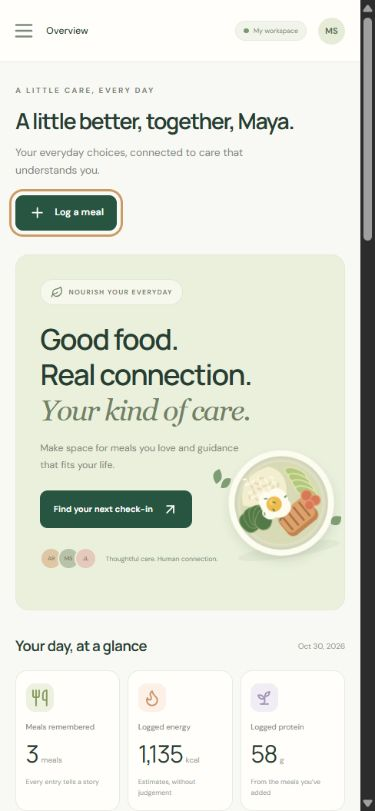

# Savor Care verification — 30 October 2026

## Result

The local build passed and all 21 automated checks passed. The patient and dietitian flows listed below were also exercised in the browser using fictional records in an isolated QA database. This is not a claim that every possible input or external service condition has been verified.

The deployed site at https://nutrition-finals.onrender.com showed **“This service has been suspended by its owner.”** It was checked at the start and end of this session. No live account or patient record was changed. Hosted acceptance testing remains blocked until the service is resumed.

## Browser coverage

| Area | Observed result |
| --- | --- |
| Invalid login | Incorrect-password error appeared; dashboard stayed inaccessible. |
| Patient and dietitian sign-in | Both fictional accounts opened their respective workspaces. |
| Registration | A fictional new patient was created and automatically signed in with empty journal, appointments, and notes. |
| Empty states | Empty food journal and care-plan screens displayed their guidance. |
| Meal entry | Saved a lunch with calories, fractional protein, fiber, and a note. Blank required name was rejected by browser validation. |
| Journal | Search found the QA meal; nutrition summary matched its entries. Native date changes updated the list and empty-date results. |
| Meal deletion | Confirmed removal of the QA entry; entry disappeared from the journal. |
| Hydration | Add/remove updated the counter. A new account started at zero with decrement disabled. |
| Booking | Past slots were disabled. A selected future slot saved and appeared in Appointments. |
| Cancellation | Confirmation moved the appointment to Cancelled and reduced the upcoming count. |
| Clinician completion | Confirmation moved the appointment to Completed. |
| Patient chart | Clinician could see the patient's newly saved journal entry. |
| SOAP note | Saved one shared note and one private note. |
| Care-plan privacy | Patient saw the shared plan only, including after page reload; private note and subjective/objective/assessment sections were absent. |
| Reading room | All three original articles opened with full content and closed successfully. |
| Logout/reload | Sign-out returned to login. Reload retained the signed-in session and saved plan. |
| Video | Appointment opened a unique Jitsi room; external script loaded and the actual Jitsi pre-join/name screen rendered. Camera/microphone permission was not granted. |
| Keyboard/dialogs | Dialog background became inaccessible; Escape closed the dialog and returned focus to its opening button. Forward/backward Tab wrapped within the dialog. |
| Responsive layout | Desktop at 1440 × 1000 and mobile at 390 × 844 checked. Mobile menu opened and navigated; meal form and care-plan empty state were reachable. No horizontal overflow observed on the mobile dashboard. |

## Fixes made during verification

1. **Valid multilingual notes rejected:** Four allowed 3,000-character fields could exceed the 32 KB JSON request limit. The notes endpoint now permits 96 KB, while field limits and the general 32 KB limit remain enforced. A regression test reproduces the original HTTP 413 failure and now passes. A payload beyond 96 KB is still rejected.
2. **Dialog accessibility:** Background navigation was exposed while a modal was open, and focus restoration could fail. Background sections are now made inert after the opening control is captured, and their original inert states are restored on close.
3. **Collapsed mobile sidebar:** Navigation outside the viewport is now inert and hidden from assistive technology while the mobile menu is closed.

## Automated coverage

Run `npm test` (Node 24+). The two test files contain 21 checks covering:

- Anonymous-access rejection for every protected workflow; wrong-role and record-ownership rejection.
- Login, registration validation, duplicate-account rejection, session cookies, replacement/expired sessions, logout revocation, and production origin requirements.
- Valid/invalid meal fields, nutrition bounds, calendar/time validation, and deletion ownership.
- Hydration integer/range/date validation and persistence.
- Booking conflicts, simultaneous booking attempts, future/clinic-slot validation, cancellation freeing slots, and completed-visit state rules.
- Shared-plan filtering, private-note exclusion, isolation between clinicians, and long multilingual notes.
- Malformed JSON, wrong content type, invalid cookies, API 404 responses, oversized payloads, and cross-origin writes.
- SQLite data/session survival when reopening the same database file.

The production frontend build (`npm run build`) also passed.

## Remaining acceptance checks

- **Hosted app:** Resume Render and verify login, meal/appointment/note changes over its HTTPS URL after redeploying these fixes. The hosted app's environment values and deployment logs were not accessible in this session.
- **Real video call:** Have a patient and dietitian join the same appointment on two devices, complete any external Jitsi moderator sign-in, and verify both directions of camera/audio plus leaving/rejoining. Reaching pre-join alone does not prove a call works.
- **Hosted durable storage:** The current local-SQLite version on Render Free still loses newly saved records when its filesystem resets. Turso integration has not been implemented. Local database persistence does not resolve this hosting limitation.
- Docker execution, other browsers/devices, all network outage cases, and screen-reader testing with a human user were not performed.

## Visual evidence

